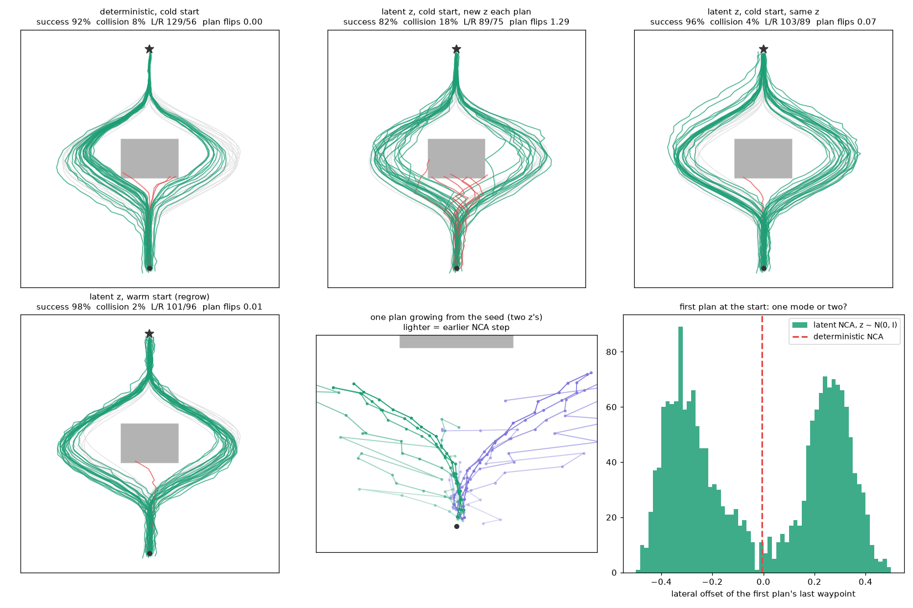
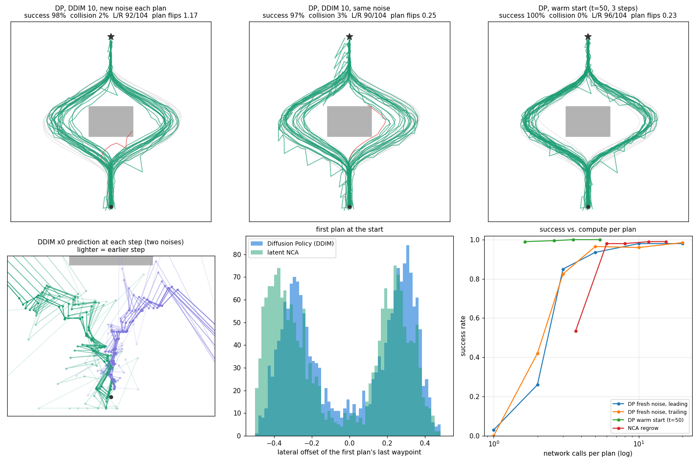

# Action NCA：用神经元胞自动机“长出”机器人动作序列

*Growing robot action chunks with a 1D Neural Cellular Automaton instead of denoising them from noise — a toy-scale study with a Diffusion Policy baseline.*

Diffusion Policy 从高斯噪声出发，去噪若干次得到一段未来动作（动作块）。这个项目把去噪换成一维神经元胞自动机（NCA）：动作块里的每个未来时间步是一个细胞，从代表“现在”的种子细胞开始，靠一个所有细胞共享的小网络局部更新，把整段轨迹“长”出来。

要检验的问题：

1. 只在种子细胞里放一个低维隐变量 z，能否表达多模态动作分布？
2. 把滚动时域执行做成“再生”（切掉已执行的细胞、前移、补尾、续长），是否比每次从头生成更省步数、模态更连贯？
3. 和同一任务上的 Diffusion Policy 相比，孰优孰劣？

## 方法概要

- **细胞**：16 个细胞对应未来 16 步；每个细胞状态 = 2 个动作通道（目标位置 x, y）+ 22 个隐藏通道。
- **感知与更新**：沿时间轴的固定卷积核（恒等、一阶和二阶差分）+ 时间位置 + 观测编码 → 共享 MLP（约 1 万参数）输出状态增量；每步随机一半细胞更新（同 Growing NCA）。
- **种子**：左边界的固定细胞，写入当前位置和 4 维隐变量 z。冷启动时所有细胞先停在当前位置，不从噪声出发。
- **多模态训练**：min-of-K（IMLE 式），同一观测试 K 个 z，只用离示范最近的那个算损失。
- **再生训练**：Growing NCA 式样本池，训练“切掉已执行部分、续长尾巴”。

**玩具任务**：二维点机器人从下方起点绕过中间的矩形障碍到达上方目标。示范一半左绕、一半右绕，且开头一段是直线，只看位置分辨不出该往哪边绕。每次预测 16 步、执行 4 步。

## 主要结果

单个训练种子（seed 0），每种方式评估 200 回合（评估种子 1），结论可能不稳。完整记录和分析见 [NOTES.md](NOTES.md)。

### NCA 本身（`results/`，默认参数）

| 执行方式 | 成功率 | 碰撞率 | 每回合计划翻转 | 每次规划的 NCA 步数 |
|---|---|---|---|---|
| 确定性 NCA，冷启动 | 92.5% | 7.5% | 0 | 32 |
| 隐变量，冷启动，每次换新 z | 82% | 18% | 1.29 | 32 |
| 隐变量，冷启动，z 固定 | 96% | 3.5% | 0.07 | 32 |
| 隐变量，热启动再生 | 98.5% | 1.5% | 0.005 | 11.7 |



### 和 Diffusion Policy 对比（`results/dp_baseline/`）

DP：条件 1D U-Net（FiLM）+ DDIM 10 步，EMA 权重，输入输出和 NCA 完全相同。“小 DP”每次网络调用的乘加数（0.19 M）和 NCA 每一步（0.17 M）相当。DP 热启动 = 上一段计划前移、加噪到第 50 步（共 100 步）、少步去噪（SDEdit 式）。NCA 是本机重训的模型，和上表的数字略有出入。

| 执行方式 | 成功率 | 碰撞率 | 计划翻转 | 每次规划的网络调用 | 每次规划的乘加 |
|---|---|---|---|---|---|
| DP 小（5 万参数），每次新噪声 | 98% | 2% | 1.17 | 10 | 1.9 M |
| DP 小，固定噪声 | 97% | 3% | 0.25 | 10 | 1.9 M |
| DP 小，热启动（1 步 DDIM） | 99% | 1% | 0.29 | 1.6 | 0.3 M |
| DP 小，热启动（3 步 DDIM） | 100% | 0% | 0.23 | 3.5 | 0.67 M |
| DP 大（111 万参数），每次新噪声 | 98.5% | 1.5% | 1.13 | 10 | 47 M |
| 流匹配小（同一 U-Net），每次新噪声（Euler 10 步） | 99.5% | 0.5% | 1.15 | 10 | 1.9 M |
| 流匹配小，每次新噪声（Euler 1 步） | 94.5% | 5.5% | 0.43 | 1 | 0.19 M |
| 流匹配小，热启动（3 步） | 100% | 0% | 0.27 | 3.5 | 0.67 M |
| NCA 隐变量，每次新 z | 81% | 19% | 1.31 | 32 | 5.6 M |
| NCA 隐变量，z 固定 | 96.5% | 3.5% | 0.08 | 32 | 5.6 M |
| NCA 隐变量，再生 | 99% | 1% | 0.01 | 11.7 | 2.0 M |



### 目前的结论

1. 只在种子里放一个 4 维 z 就能长出两个模态；起点处第一段计划是清晰的双峰（约 51% 左、47% 右）。
2. 再生执行比每次从头生成省步数、模态更连贯。但**这不是 NCA 独有的**：DP 用 SDEdit 式热启动同样省步数，在单次调用算力相当时需要的调用更少。
3. 每次重新采随机性时，DP 和 NCA 的计划翻转次数差不多，但 DP 几乎不撞（2%），NCA 撞得多（19%），原因待查。
4. NCA 真正领先的是**模态一致性**：再生时计划翻转 0.01，DP 是 0.23–0.29。在这个玩具任务上，这还没有转化成成功率的差距。
5. 把扩散换成流匹配（π0 一类 VLA 的做法）后，DP 在少步数时更强：只用 1 次网络调用就有 94.5%，NCA 在算力上的说法更站不住。
6. 小 DP 对结构超参敏感（GroupNorm 组数不对时完全训练不起来）。NCA 没有经过同等程度的调参，训练样本也更少，比较并不完全对等。

## 运行

```bash
pip install -r requirements.txt

# NCA：训练确定性和隐变量两个模型并评估（单核 CPU 约 11 分钟）
python action_nca.py
python sweep_steps.py --model nca_out/nca_latent.pt      # 扫描生长步数

# Diffusion Policy 基线（Apple GPU 上约 8 分钟；有 NVIDIA GPU 用 --device cuda）
python diffusion_baseline.py --device mps --train_only
python diffusion_baseline.py --load dp_out/dp_policy.pt  # CPU 上评估，并和 nca_out/ 里的 NCA 对比

# 和 NCA 每步算力相当的小 DP
python diffusion_baseline.py --device mps --train_only --dims 8 16 32 --kernel 3 --t_dim 16 --groups 2 --lr 2e-3 --out dp_out/small
python diffusion_baseline.py --load dp_out/small/dp_policy.pt --out dp_out/small

# 流匹配版本（π0 一类 VLA 的动作头做法）：加 --method flow，其余参数相同
python diffusion_baseline.py --method flow --device mps --train_only --out dp_out/flow
python diffusion_baseline.py --load dp_out/flow/dp_policy.pt --out dp_out/flow
```

新的运行输出写到 `nca_out/` 和 `dp_out/`（不纳入版本控制）。

## 文件

| 路径 | 内容 |
|---|---|
| `action_nca.py` | NCA 单文件原型：数据生成、模型、训练、闭环评估、画图 |
| `sweep_steps.py` | 扫描冷启动和再生的 NCA 步数 |
| `diffusion_baseline.py` | Diffusion Policy 基线（扩散 + DDIM，或 `--method flow` 流匹配），以及 NCA 和 DP 共用的闭环评估 `rollout()` |
| `results/` | NCA 默认参数的基线结果（`metrics.json`、`results.png`、`sweep.txt`、`train_log.txt`） |
| `results/nca_rerun_local/` | 本机按默认参数重训的 NCA（DP 对比用的就是它） |
| `results/dp_baseline/` | DP 各配置的对比表、指标、图和日志：`large`、`small`（选定的小模型）、`mid`、流匹配的 `flow_large` 和 `flow_small`，以及两个落选的小模型配置 |
| `NOTES.md` | 背景、设计理由、全部实验结果和被修正过的判断 |
| `CLAUDE.md` | 给 Claude Code 的项目说明 |

## 局限与下一步

- 二维玩具任务、状态输入、障碍和目标位置固定、只有一个训练种子。
- 下一步：多个随机种子重复主要实验；随机化障碍和目标位置检验泛化；迁移到带图像观测的 Push-T。

## 参考

- Chi et al., *Diffusion Policy: Visuomotor Policy Learning via Action Diffusion*, RSS 2023.
- Mordvintsev et al., *Growing Neural Cellular Automata*, Distill 2020.
- Palm et al., *Variational Neural Cellular Automata*, ICLR 2022.
- Li & Malik, *Implicit Maximum Likelihood Estimation*, 2018.
- Meng et al., *SDEdit: Guided Image Synthesis and Editing with Stochastic Differential Equations*, ICLR 2022.
